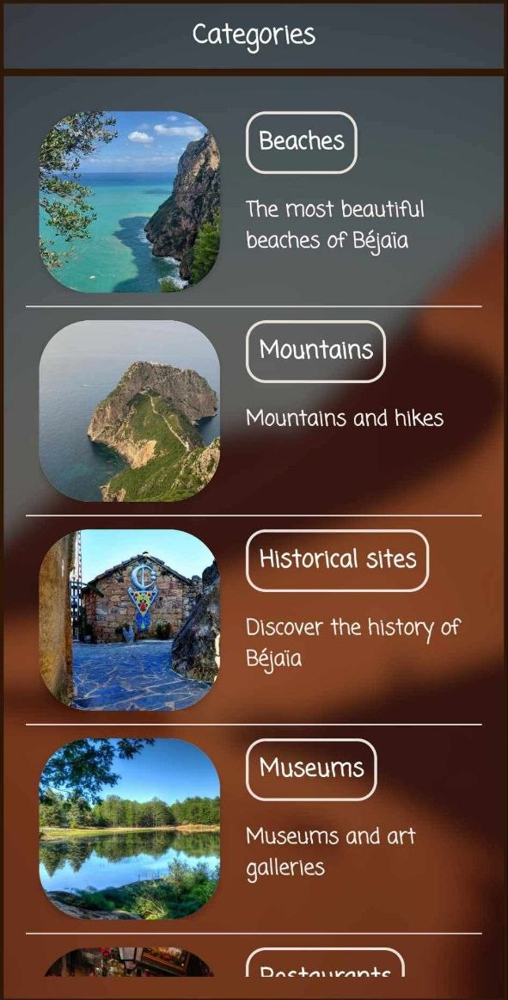
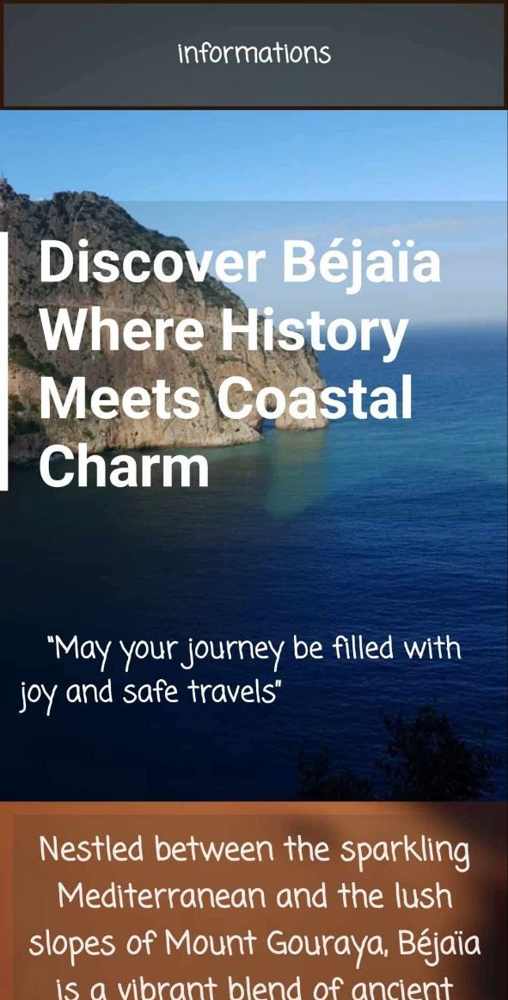

<div align="center">

# Guide Touristique — Béjaïa

**Application Android pour découvrir la perle de la Méditerranée**


</div>

---

## À propos

**Guide Touristique** est une application Android écrite en Java qui présente la ville de **Béjaïa** (Algérie) aux visiteurs. 
Elle regroupe les lieux à découvrir par catégorie, avec des photos, des descriptions, des avis et des actions rapides pour contacter un établissement ou s'y rendre.


## Aperçu

<p align="center">
  
  
  
</p>
## Fonctionnalités

| Fonctionnalité | Description |
|---|---|
| **Accueil** | Carrousel d'images avec défilement automatique (3 s), passage manuel d'un clic et indicateur de position |
| **7 catégories** | Plages, montagnes, sites historiques, musées, restaurants, parcs et hôtels |
| **Fiches des sites** | Galerie d'images défilante, description, localisation et avis des visiteurs |
| **Actions rapides** | Appeler, envoyer un SMS ou un e-mail directement depuis la fiche |
| **Navigation GPS** | Itinéraire vers la ville via Google Maps |
| **Bilingue** | Bascule entre l'anglais et l'arabe, avec affichage droite-à-gauche |
| **Page d'informations** | Présentation générale de la ville |

## Technologies

| | |
|---|---|
| **Langage** | Java |
| **Plateforme** | Android (minSdk 24 · targetSdk 35) |
| **Build** | Gradle (Kotlin DSL) |
| **Interface** | AppCompat, Material Components, ConstraintLayout, GridLayout, ListView / RecyclerView |

## Installation

### Prérequis
- [Android Studio](https://developer.android.com/studio) (version récente)
- Un émulateur Android ou un téléphone avec le mode développeur activé

### Étapes

1. **Cloner le dépôt**
   ```bash
   git clone https://github.com/Siamsell/-Guide-Touristique-de-B-ja-a-Application-Android.git
   ```
2. **Ouvrir le projet** dans Android Studio (*File > Open*).
3. **Attendre la synchronisation Gradle** : le fichier `local.properties` est créé automatiquement.
4. **Lancer l'application** avec le bouton **Run**.


[](https://github.com/Siamsell)
